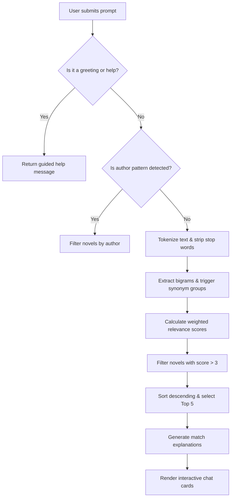

# NovelVerse — Complete Build Documentation

> **Project:** AI Novel Discovery Website  
> **Created:** November 5, 2026  
> **Tech Stack:** HTML5, CSS3, JavaScript ES6+ (Vanilla / Zero Build Dependencies)  
> **Location:** `c:\Users\Kenneth Lumod\Downloads\AI Novel Recommendation Chatbot\`

---

## Table of Contents

1. [Project Structure](#1-project-structure)
2. [HTML Pages Created](#2-html-pages-created)
3. [CSS Stylesheets Created](#3-css-stylesheets-created)
4. [JavaScript Files Created](#4-javascript-files-created)
5. [Novel Dataset (35 Novels Summary)](#5-novel-dataset-35-novels-summary)
6. [AI Chatbot Engine Details](#6-ai-chatbot-engine-details)
7. [Design System](#7-design-system)
8. [Responsive Breakpoints](#8-responsive-breakpoints)
9. [How to Add New Novels & Customize Data](#9-how-to-add-new-novels--customize-data)
10. [Step-by-Step Testing & Verification Guide](#10-step-by-step-testing--verification-guide)
11. [Troubleshooting & Frequently Asked Questions](#11-troubleshooting--frequently-asked-questions)
12. [Future Backend & AI Integration Roadmap](#12-future-backend--ai-integration-roadmap)

---

## 1. Project Structure

```
AI Novel Recommendation Chatbot/
│
├── index.html              (7,227 bytes)   Home page
├── library.html            (6,440 bytes)   Novel library/browse page
├── novel.html              (4,629 bytes)   Novel detail page
├── about.html              (9,107 bytes)   About page
├── README.md               (9,447 bytes)   Project documentation in workspace
│
├── css/
│   ├── styles.css          (20,128 bytes)  Main stylesheet
│   ├── chatbot.css         (6,192 bytes)   Chatbot sidebar styles
│   └── responsive.css      (4,154 bytes)   Mobile/tablet breakpoints
│
└── js/
    ├── data.js             (38,078 bytes)  Novel dataset (35 entries)
    ├── chatbot.js          (19,075 bytes)  AI recommendation engine
    ├── app.js              (7,501 bytes)   Home page logic
    ├── library.js          (7,523 bytes)   Library page logic
    ├── novel-detail.js     (7,462 bytes)   Detail page logic
    └── about.js            (1,268 bytes)   About page logic

Total: 15 files | ~158 KB total
```

---

## 2. HTML Pages Created

### 1. `index.html` — Home Page
- **AI Chatbot Sidebar:** Fixed left sidebar (350px) with initial welcome message, interactive suggestions, scrollable history, and text input.
- **Chatbot Floating Trigger:** Floating round launcher button (`#chatbotOpen`) located at bottom-left when sidebar is closed.
- **Navigation Bar:** Sticky top navigation containing brand icon + text ("NovelVerse"), links (`Home`, `Library`, `About`), and a responsive hamburger icon.
- **Hero Section:** High-impact banner with gradient headline ("Find Your Next Story"), subtext, direct query search bar, and animated metric counters.
- **Popular Novels:** Ranked gallery of top 10 novels sorted by popularity score (`rating * log(ratingsCount)`).
- **Genre Directory:** Responsive cards with Font Awesome iconography mapping directly to filtered library views.
- **Recently Added:** Chronologically organized catalog of newest novel additions.
- **Footer:** Brand summary, navigation links, and platform copyright.

### 2. `library.html` — Novel Library Page
- **Persistent AI Assistant:** Left sidebar remains accessible across browsing sessions.
- **Library Controls:**
  - Real-time text search (searches title, author, description, tags, genres).
  - Genre filter dropdown dynamically populated from dataset.
  - Status filter dropdown (`Ongoing`, `Completed`, `Hiatus`).
  - Sort dropdown (`Title A-Z`, `Highest Rated`, `Most Chapters`, `Recently Added`).
- **Dynamic Pagination:** 20 novels per page with numeric buttons, previous/next buttons, and ellipses.
- **Deep Linking Support:** URL parameters automatically pre-fill filters (`?genre=Fantasy` or `?search=reincarnation`).

### 3. `novel.html` — Novel Detail Page
- **Header & Back Navigation:** "← Back to Library" link restoring previous state.
- **Detailed Layout:**
  - High-resolution 2:3 aspect ratio cover container (with fallback procedural placeholder).
  - Main title, author with accent styling.
  - Metadata badges: Rating with star, review count, chapters, views count (formatted with K/M units), publication status badge, release year, language.
  - Genre chips and trope tag pills.
  - Full formatted narrative synopsis.
- **"You Might Also Like" Recommendation Engine:** Calculates contextual similarity score (+3 for shared genres, +2 for shared tags) and surfaces top 5 related novels.

### 4. `about.html` — About & Guide Page
- **Platform Overview:** 4 cards highlighting Purpose, AI Matching Engine, Curated Collection, and Technical Stack.
- **How-to-Use Walkthrough:** 4-step sequence (Open AI Chat → Describe Desired Story → Receive Top 5 Recommendations → Read & Explore).
- **Interactive Query Chips:** Clickable sample queries (e.g., *"I want a novel where the MC is overpowered from the start"*). Clicking expands the chatbot on any screen size and automatically executes the search.

---

## 3. CSS Stylesheets Created

### `css/styles.css` — Main Stylesheet
- **CSS Variables / Design Tokens:**
  - Background: `--bg-primary: #171923;`
  - Containers / Cards: `--bg-secondary: #252839;`
  - Elements / Chips: `--bg-tertiary: #1E2033;`
  - Hover States: `--bg-hover: #2D3048;`
  - Brand Accent: `--accent: #A78BFA;`
  - Brand Accent Light: `--accent-hover: #C4B5FD;`
  - Subtle Highlights: `--accent-dim: rgba(167, 139, 250, 0.15);`
  - Primary Text: `--text-primary: #F3F4F6;`
  - Secondary Text: `--text-secondary: #9CA3AF;`
  - Status Colors: `--success: #34D399;`, `--warning: #FBBF24;`, `--danger: #F87171;`
- **Component Styling:**
  - Glassmorphic top navigation with `backdrop-filter: blur(20px)`.
  - 2:3 aspect ratio portrait cards with scale hover animations.
  - Procedural SVG background patterns and placeholder graphics.
  - Pagination controls and custom select inputs.

### `css/chatbot.css` — Chatbot Styles
- 350px fixed left sidebar with independent scroll container.
- Distinct bubble styles for AI assistant (accent-bordered dark bubble) and user messages (right-aligned, tinted background).
- Mini card recommendations within messages featuring 50×70px cover thumbnails, titles, genres, and match reasons.
- Animated 3-dot typing indicator using staggered pulse keyframes.
- Floating round action button for opening sidebar on mobile or collapsed view.

### `css/responsive.css` — Breakpoints
- **Desktop (> 1024px):** Persistent sidebar + fluid main content grid.
- **Tablet (≤ 1024px):** 4 cards per row, adjusted typography.
- **Small Tablet / Mobile (≤ 768px):** Chatbot slides off-screen; opens as an overlay via floating toggle; top navigation converts to collapsible hamburger menu.
- **Phone (≤ 480px):** Full-width chatbot drawer, 2-column card grid, stacked filter bars.

---

## 4. JavaScript Files Created

### `js/data.js` — Novel Dataset
- Exposes `NOVELS` array containing 35 full web novel records.
- Utility functions: `getAllGenres()`, `getAllTags()`, `getGenreCounts()`.
- `GENRE_ICONS` mapping Font Awesome classes to genres.

### `js/chatbot.js` — Recommendation Engine
- `NovelChatbot` class managing message states, UI events, and persistence.
- **TF-IDF & Weighted Semantic Matcher:**
  - Title match: +10 pts
  - Tag match: +9 pts
  - Genre match: +8 pts
  - Author match: +7 pts
  - Exact synopsis match: +2 pts
  - Bigram phrase match: +5 pts
  - Full phrase bonus: +15 pts (description) / +20 pts (title)
  - 30+ trope synonym expansion groups: +4 pts per matching concept
- Automated author extraction using regular expression pattern matching.
- Match explanation generator producing human-readable reason strings.

### `js/app.js` — Homepage Logic
- Particle canvas animation in hero banner.
- Animated stats counter using cubic ease-out calculation.
- Popularity formula: `rating * Math.log(ratingsCount)` for ranking top reads.

### `js/library.js` — Library Logic
- Filter pipeline combining keyword search, genre, and status filters.
- Sorter implementation (A-Z, Rating, Chapters, Year).
- Dynamic pagination with URL search params preservation.

### `js/novel-detail.js` — Novel Details Logic
- Parses query parameter `?id=...`.
- Reconstructs full metadata view with status indicators and formatted view counts.
- Similar novel engine filtering by overlapping tags and genres.

### `js/about.js` — About Controller
- Connects interactive query chips with the chatbot engine.

---

## 5. Novel Dataset (35 Novels Summary)

| # | Title | Author | Primary Genres | Status | Rating | Chapters |
|---|---|---|---|---|---|---|
| 1 | Super Supportive | Sleyca | Progression Fantasy, Sci-Fi | Ongoing | 4.82 | 320 |
| 2 | The Game at Carousel | Codexor | LitRPG, Horror, Urban Fantasy | Ongoing | 4.71 | 245 |
| 3 | Die, Respawn, Repeat | Bathrobe Knight | LitRPG, Progression Fantasy | Ongoing | 4.65 | 280 |
| 4 | Defiance of the Fall | TheFirstDefier | LitRPG, Cultivation, Action | Ongoing | 4.38 | 1,450 |
| 5 | The Primal Hunter | Zogarth | LitRPG, Action, Adventure | Ongoing | 4.25 | 1,250 |
| 6 | Dungeon Crawler Carl | Matt Dinniman | LitRPG, Comedy, Adventure | Completed | 4.78 | 350 |
| 7 | Stray Cat Strut | RavensDagger | Sci-Fi, Cyberpunk, Action | Ongoing | 4.30 | 520 |
| 8 | The Runesmith | Kuropon | LitRPG, Fantasy, Crafting | Ongoing | 4.15 | 650 |
| 9 | Aura Overload | Plum Parrot | Progression Fantasy, Action | Ongoing | 4.55 | 180 |
| 10 | The Wandering Inn | pirateaba | Fantasy, Slice of Life, LitRPG | Ongoing | 4.60 | 3,000 |
| 11 | Beneath the Dragoneye Moons | Selkie | Progression Fantasy, LitRPG | Ongoing | 4.22 | 950 |
| 12 | Shadow Slave | Guiltythree | Dark Fantasy, Progression Fantasy | Ongoing | 4.70 | 1,800 |
| 13 | Beware of Chicken | Casualfarmer | Xianxia, Comedy, Slice of Life | Ongoing | 4.68 | 450 |
| 14 | Mark of the Fool | J.M. Clarke | Progression Fantasy, Academy | Ongoing | 4.42 | 750 |
| 15 | He Who Fights with Monsters | Shirtaloon | LitRPG, Progression Fantasy | Ongoing | 4.18 | 1,150 |
| 16 | Mother of Learning | nobody103 | Fantasy, Mystery, Adventure | Completed | 4.75 | 108 |
| 17 | Azarinth Healer | Rhaegar | LitRPG, Action, Adventure | Completed | 4.10 | 960 |
| 18 | Forge of Destiny | Yrsillar | Xianxia, Fantasy | Ongoing | 4.48 | 420 |
| 19 | Paranoid Mage | InadvisablyCompelled | Urban Fantasy, Thriller | Ongoing | 4.35 | 310 |
| 20 | Thousandth Son of the King | QueenRen | Fantasy, Drama, Action | Ongoing | 4.52 | 280 |
| 21 | Salvos | MelasD | Progression Fantasy, Comedy | Ongoing | 4.20 | 800 |
| 22 | The Perfect Run | Void Herald | Superhero, Sci-Fi, Comedy | Completed | 4.62 | 130 |
| 23 | Virtuous Sons | Ya Boy | Xianxia, Historical Fantasy | Hiatus | 4.45 | 190 |
| 24 | The Calamitous Bob | Mecanimus | Dark Fantasy, LitRPG, Comedy | Ongoing | 4.40 | 560 |
| 25 | Path of Ascension | C_Mantis | Progression Fantasy, Sci-Fi | Ongoing | 4.32 | 680 |
| 26 | A Practical Guide to Sorcery | AzaleaEllis | Fantasy, Mystery, Academy | Ongoing | 4.50 | 350 |
| 27 | Chrysalis | RinoZ | LitRPG, Adventure, Comedy | Ongoing | 4.35 | 1,100 |
| 28 | Reverend Insanity | Gu Zhen Ren | Xianxia, Dark Fantasy | Hiatus | 4.58 | 2,334 |
| 29 | Lord of the Mysteries | Cuttlefish That Loves Diving | Fantasy, Mystery, Horror | Completed | 4.80 | 1,432 |
| 30 | Omniscient Reader's Viewpoint | Sing Shong | Fantasy, Sci-Fi, Drama | Completed | 4.76 | 551 |
| 31 | Solo Leveling | Chugong | Action, Fantasy, LitRPG | Completed | 4.45 | 270 |
| 32 | The Beginning After the End | TurtleMe | Fantasy, Action, Reincarnation | Ongoing | 4.50 | 500 |
| 33 | Legendary Mechanic | Chocolion | Sci-Fi, LitRPG, Comedy | Completed | 4.30 | 1,463 |
| 34 | Pale Lights | ErraticErrata | Dark Fantasy, Adventure | Ongoing | 4.58 | 160 |
| 35 | Reborn as a Demonic Tree | Ashkante | Xianxia, Fantasy, Slice of Life | Ongoing | 4.28 | 380 |

---

## 6. AI Chatbot Engine Details

### Recommendation Pipeline



---

## 7. Design System

### Colors & Hierarchy
- **Base Background:** `#171923`
- **Surface Elevation:** `#252839`
- **Container / Message Bubbles:** `#1E2033`
- **Primary Brand Purple:** `#A78BFA`
- **Brand Glow:** `rgba(167, 139, 250, 0.3)`
- **Body Font:** Inter (`sans-serif`), weights 300 to 800

---

## 8. Responsive Breakpoints

| Device Category | Viewport Width | Chatbot Behavior | Content Grid |
|---|---|---|---|
| **Desktop Monitors** | `> 1024px` | Fixed 350px left sidebar | 4–5 columns |
| **Laptops & Tablets** | `769px – 1024px` | Fixed 300px left sidebar | 3–4 columns |
| **Small Tablets / Phones** | `481px – 768px` | Off-screen drawer (toggle open) | 2–3 columns |
| **Mobile Phones** | `≤ 480px` | Fullscreen modal drawer | 1–2 columns |

---

## 9. How to Add New Novels & Customize Data

To expand the platform with additional novels, open [`js/data.js`](file:///c:/Users/Kenneth%20Lumod/Downloads/AI%20Novel%20Recommendation%20Chatbot/js/data.js) and append a new object to the `NOVELS` array:

```javascript
{
    id: 36,
    title: "Your Novel Title",
    author: "Author Name",
    description: "Detailed narrative synopsis describing the main character, conflict, setting, and themes...",
    coverImage: "https://example.com/cover.jpg", // Leave empty string "" for automatic placeholder
    genres: ["Fantasy", "Action", "LitRPG"],
    tags: ["Overpowered Protagonist", "Magic System", "Reincarnation"],
    rating: 4.75,
    ratingsCount: 5200,
    chapters: 240,
    views: 1200000,
    status: "Ongoing", // "Ongoing", "Completed", or "Hiatus"
    language: "English",
    year: 2024
}
```

> [!TIP]
> **No rebuild or compilation required.** Refresh the browser and the new novel will instantly appear in search results, the library catalog, and AI chatbot recommendations.

---

## 10. Step-by-Step Testing & Verification Guide

### 1. Test Chatbot Story Searches
- **Query 1:** `"I want a strong MC who gets betrayed"`
  - *Expected Top Matches:* Shadow Slave, Thousandth Son of the King, Reverend Insanity.
- **Query 2:** `"time loop stories where protagonist resets on death"`
  - *Expected Top Matches:* Mother of Learning, Die, Respawn, Repeat, The Perfect Run.
- **Query 3:** `"cozy xianxia farming with animals"`
  - *Expected Top Matches:* Beware of Chicken, Reborn as a Demonic Tree.

### 2. Test Author Lookups
- **Query:** `"novels by pirateaba"`
  - *Expected Match:* The Wandering Inn.

### 3. Test Library Filtering & Sorting
- Navigate to `library.html`.
- Set **Genre** to `LitRPG` $\rightarrow$ Result count updates to 13.
- Set **Status** to `Completed` $\rightarrow$ Shows Dungeon Crawler Carl, Azarinth Healer, Solo Leveling, Legendary Mechanic.
- Change **Sort By** to `Highest Rated` $\rightarrow$ Inspect cards order.

---

## 11. Troubleshooting & Frequently Asked Questions

### Q: Why do novel cards show placeholder icons instead of images?
**A:** `coverImage` is initialized to empty strings `""` by default to ensure 100% offline functionality without broken link icons. To add real covers, provide image URLs or local relative paths in `js/data.js`.

### Q: How do I change the chatbot's width?
**A:** In [`css/styles.css`](file:///c:/Users/Kenneth%20Lumod/Downloads/AI%20Novel%20Recommendation%20Chatbot/css/styles.css), modify the root variable:
```css
:root {
    --sidebar-width: 380px; /* Adjust as needed */
}
```

### Q: Does the chatbot require an internet connection?
**A:** No. The entire search, scoring, tokenization, and synonym expansion pipeline runs directly in client-side JavaScript.

---

## 12. Future Backend & AI Integration Roadmap

If you decide to connect this frontend to a real Large Language Model (e.g., Gemini, OpenAI, Claude, or local Ollama), you can easily replace `processQuery(query)` in [`js/chatbot.js`](file:///c:/Users/Kenneth%20Lumod/Downloads/AI%20Novel%20Recommendation%20Chatbot/js/chatbot.js):

```javascript
async processQuery(query) {
    try {
        const response = await fetch('/api/recommend', {
            method: 'POST',
            headers: { 'Content-Type': 'application/json' },
            body: JSON.stringify({ prompt: query, catalog: NOVELS })
        });
        const data = await response.json();
        this.displayRecommendations(data.recommendations, data.explanation);
    } catch (err) {
        // Fallback to local TF-IDF engine
        const results = this.searchNovels(query);
        this.displayRecommendations(results.slice(0, 5), "Local search results:");
    }
}
```
